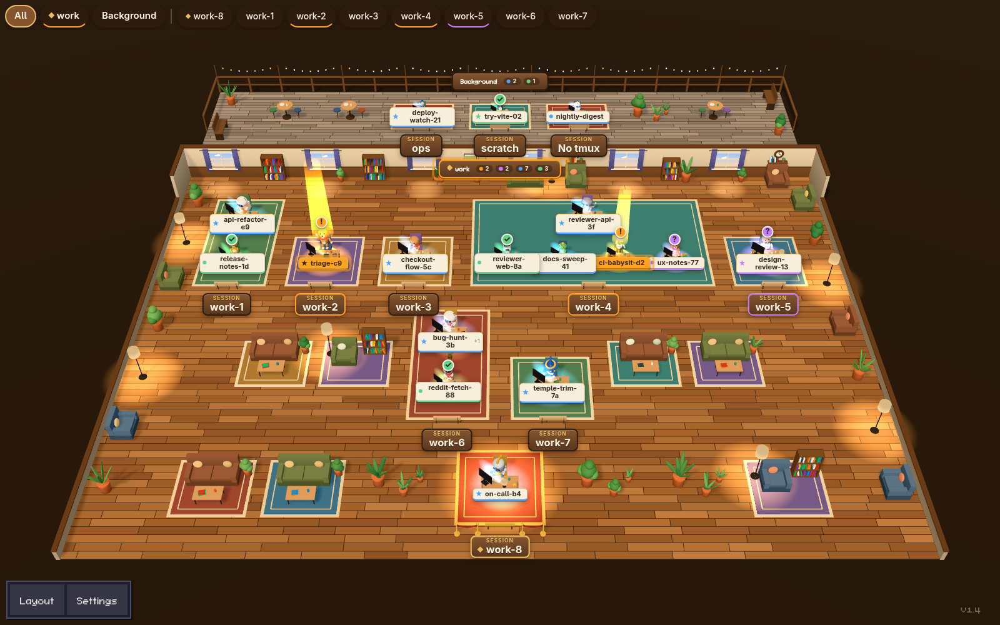

# tmux office

A 3D office for the Claude Code sessions in your tmux. Each tmux session is a pod with a sign. One agent per session oversees it from the back of the pod, and the rest of its crew sit in front. Each agent acts out what it is doing. Its sub-agents are goblins that hammer in front of its desk.



Watch [the 57-second tour](docs/media/tmux-office-tour.mp4). Its music is "Lofi Chill" by ZephiraMusic from Pixabay, under the Pixabay Content License.

tmux office is built on [Pixel Agents](https://github.com/pixel-agents-hq/pixel-agents) (MIT). It keeps the Pixel Agents server, hooks, and pixel view. It adds a three.js office, tmux rooms, a terminal panel per desk, and a read-only JSON feed.

## Read the office at a glance

| Status            | What the character does                                  |
| ----------------- | -------------------------------------------------------- |
| Working           | Types at a lit monitor in blue light.                    |
| Needs permission  | Stands and raises a hand under an amber beam with a `!`. |
| Waiting for input | Shows a violet `?` inside a violet ring.                 |
| Done              | Cheers once with confetti, then shows a green check.     |
| Idle              | Dozes behind a drifting `z`.                             |

- A pod's sign reads **SESSION** over the tmux session name. Signs draw above every desk label, so you read the session first.
- A desk card shows the agent's name with spaces for hyphens. The name is the one you gave the session with `/rename`, else the tmux window's name when you set one and no other Claude session shares that window, else Claude's name for the folder without its trailing hex id. The overseer's card has a star. Hover a card for the whole name.
- Select a desk or focus a session, then press **Rename** in the top bar to give it another name. Your browser keeps the name. Clear it to get the tmux name back.
- The live session list skips `claude -p` runs, so under `--live-only` they get no desk, even when they start inside a pane.
- Click a desk to open its tmux pane in a terminal panel, where you can watch and type. Opening a desk makes the agent's pane the active pane of its window. The panel needs Cloudflare Access or `--insecure-local-terminal`. See [Expose it safely](#expose-it-safely).
- Click a desk to select it. Its label then shows a character picker: astronaut, cat, chef, dog, frog, knight, penguin, robot, or wizard. Your browser remembers the choice per agent name. Goblins are for sub-agents only.
- Add `#work` to the URL to focus the room `work`, or `#work-1` to focus one session. A session named like a room is `#session:<name>`.
- Press **Walk** on the room bar to walk through the office at eye height. Drag to look around. W, A, S, D or the arrow keys move you, Shift runs, and Esc leaves.
- Add `?view=pixel` to the URL for the original pixel office.

## Run it

You need Node 20.19+ or 22.12+, tmux, and Claude Code running inside tmux.

The terminal panel needs node-pty, which npm may have to build with a C/C++ toolchain. The office works without it.

```bash
git clone https://github.com/falkoro/tmux-office.git
cd tmux-office
npm install
npm run build
node dist/cli.js --port 3100 --watch-all --live-only
```

The server prints a URL like `http://127.0.0.1:3100/?token=...`. Open it in a browser. The token lets the page change your Claude Code hook settings, so treat the URL as a secret.

On the first visit, a short tour asks whether to install Claude Code hooks in `~/.claude/settings.json`. With hooks, a status changes the moment Claude acts. Without hooks, the server reads the session transcripts instead, and a permission prompt shows up after about 7 seconds.

## Try it with demo sessions

To see the office without your own sessions, build once and start the demo rig:

```bash
npm run build
scripts/office-demo-rig.sh start demo 3199
```

The rig prints the office URL. It runs fake agents on a private tmux server (`tmux -L pa-demo-demo`) with a throwaway `HOME`, so it never touches your tmux server or `~/.claude`. The terminal panel works in the demo. To stop the rig, run `scripts/office-demo-rig.sh stop demo`.

## Configure rooms, pins, and overseers

Set these environment variables before you start the server.

| Variable                         | Effect                                                                                                                                                                                                                                                                                                                                                                                                                                                                                                                   |
| -------------------------------- | ------------------------------------------------------------------------------------------------------------------------------------------------------------------------------------------------------------------------------------------------------------------------------------------------------------------------------------------------------------------------------------------------------------------------------------------------------------------------------------------------------------------------ |
| `PIXEL_AGENTS_OFFICE_ROOMS`      | Groups tmux sessions into rooms. Separate entries with `;`. `name=glob` puts every matching session in a room called `name`, and `*` matches any text. Without it, every session is a room.                                                                                                                                                                                                                                                                                                                              |
| `PIXEL_AGENTS_OFFICE_PINNED`     | Sessions to pin, as names or globs separated by commas or spaces. A pinned session sits alone in the front row of its room, on a red rug.                                                                                                                                                                                                                                                                                                                                                                                |
| `PIXEL_AGENTS_OFFICE_OVERSEERS`  | Globs over agent names, separated by commas or spaces. In each session the first agent whose name matches is the overseer, and its card drops the glob's literal start. Without a match, the agent in the session's oldest window is.                                                                                                                                                                                                                                                                                    |
| `PIXEL_AGENTS_OFFICE_BACKGROUND` | `hide` drops the porch. The porch holds agents outside tmux and sessions that match no room.                                                                                                                                                                                                                                                                                                                                                                                                                             |
| `PIXEL_AGENTS_TMUX_SOCKET`       | The tmux socket to read, as in `tmux -L <name>`. Without it, the server reads the default tmux server. It must name the socket Claude runs on, because pane ids are unique only within one tmux server. On Linux a pane opens as a terminal only when `/proc` shows Claude runs in it; on macOS, which has no `/proc`, a pane with the same session name and id on another tmux server can be mistaken for Claude's. Only names of letters, digits, `_` and `-` are accepted; any other value is ignored with a warning. |

For example, to put `work-*` and `side-*` sessions in two rooms and pin `work-1`:

```bash
PIXEL_AGENTS_OFFICE_ROOMS='work=work-*;side=side-*' \
PIXEL_AGENTS_OFFICE_PINNED=work-1 \
node dist/cli.js --port 3100 --watch-all --live-only
```

## Command-line options

| Option                      | Effect                                                                                    |
| --------------------------- | ----------------------------------------------------------------------------------------- |
| `--port`, `-p <number>`     | The port to listen on. Without it, the OS picks a free port.                              |
| `--host <string>`           | The address to bind. Default: `127.0.0.1`.                                                |
| `--watch-all`               | Watch every Claude session on the machine, not only the current folder's.                 |
| `--live-only`               | Show an agent only while its Claude process runs.                                         |
| `--insecure-local-terminal` | Open the terminal panel without Cloudflare Access. Use it only for development and tests. |

## Read the office as JSON

`GET /api/office` returns every desk, without tool text or file paths:

```json
{
  "desks": [
    {
      "name": "triage-c9",
      "session": "work-2",
      "room": "work",
      "pinned": false,
      "status": "needs-permission",
      "helpers": ["working"]
    }
  ]
}
```

`status` is one of `working`, `needs-permission`, `waiting-input`, `done`, or `idle`. `helpers` holds one status per sub-agent. `room` is `null` for the porch.

A request without an `Origin` header gets the feed. A browser page gets it only when its origin is in `PIXEL_AGENTS_OFFICE_EMBED_ORIGINS`, separated by commas or spaces. Every other origin gets `403`.

## Expose it safely

The server binds to `127.0.0.1`. Anyone who reaches the port can watch your sessions, so don't bind it to a public address.

To open the office on other devices, put it behind [Cloudflare Access](https://developers.cloudflare.com/cloudflare-one/policies/access/) with a Cloudflare Tunnel, and set both of these variables:

| Variable                          | Value                                                               |
| --------------------------------- | ------------------------------------------------------------------- |
| `PIXEL_AGENTS_ACCESS_TEAM_DOMAIN` | Your Access team domain, for example `myteam.cloudflareaccess.com`. |
| `PIXEL_AGENTS_ACCESS_AUD`         | The audience (AUD) tag of the Access application.                   |

If only one of them is set, the server refuses to start and names the missing one, so a typo cannot leave the office open. With both set, it logs that the gate is on and checks the `Cf-Access-Jwt-Assertion` header on every request except hook posts. A request without a valid token gets `403`. The terminal panel opens only in this mode or with `--insecure-local-terminal`, and only for a page on the same origin. Without Access, the terminal also needs the server token.

Behind Access, a browser page on another origin cannot read `/api/office`, even when `PIXEL_AGENTS_OFFICE_EMBED_ORIGINS` lists it: the request needs the Access cookie, and the server does not allow credentialed cross-origin requests. Read the feed from a server, for example with an Access service token, or from a page on the office's own host.

## What tmux office adds to Pixel Agents

- A three.js office in the browser. The VS Code extension and the e2e suite keep the pixel view.
- tmux rooms, pods, and pins. The server follows each pane by its id, so a window moved to another session shows up in that session.
- `--live-only`, which drops agents whose Claude process has ended.
- A terminal panel per desk, and the Access gate in front of it.
- The `/api/office` feed.

Nothing is published to npm; the project runs from source via `node dist/cli.js`. `package.json` keeps the upstream name `pixel-agents`.

## Develop

```bash
npm test         # webview, server, and package-contract tests
npm run build    # types, lint, and bundles
```

[docs/office3d.md](docs/office3d.md) has the design notes for the 3D office, including its known weaknesses. [CONTRIBUTING.md](CONTRIBUTING.md) covers the server, the hooks, and the e2e suite.

## License

MIT. tmux office is built on Pixel Agents by Pablo De Lucca and its contributors. [LICENSE](LICENSE) keeps their copyright notice.
